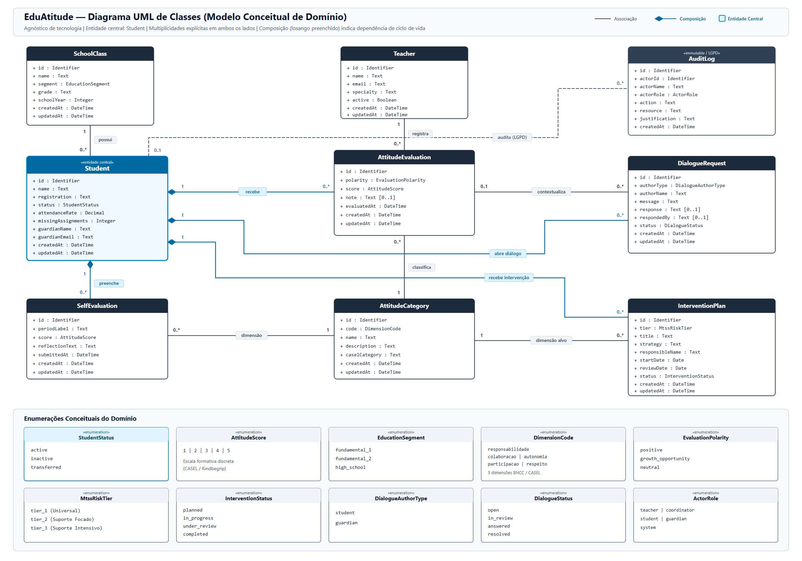
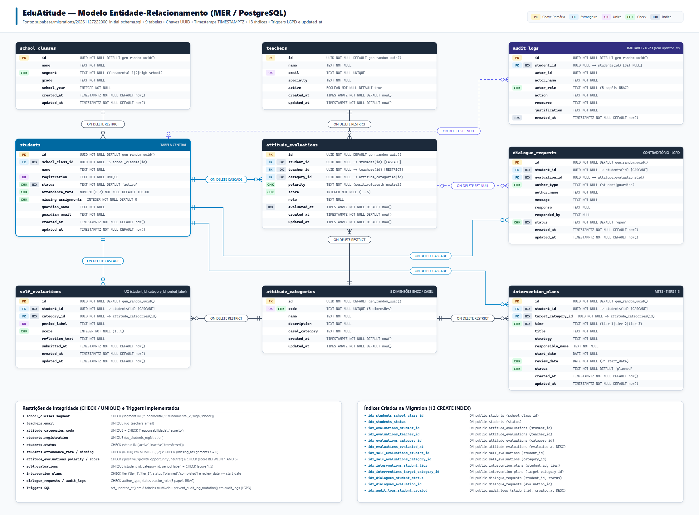

# EduAtitude — Sistema Web de Avaliação Atitudinal (Marco 1)

Sistema web voltado à **Avaliação Atitudinal e Socioemocional** na Educação Básica (Ensino Fundamental I, Fundamental II e Ensino Médio). A proposta da equipe transforma a observação atitudinal em um acompanhamento formativo contínuo, estruturado e não punitivo, orientado pelas competências da **BNCC**, pelo referencial multidimensional **Kindbegrip / CASEL** (5 dimensões: *Responsabilidade*, *Colaboração*, *Autonomia*, *Participação* e *Respeito*), pelo Sistema de Alerta Precoce **EdInsights / MTSS** (Tiers 1, 2 e 3) e pelos princípios de transparência, contraditório e auditoria da **LGPD** (Lei nº 13.709/2018), sem rankings classificatórios entre estudantes.

Este repositório corresponde ao **Marco 1 — Modelo de Domínio e Interface Mock**, estabelecendo a fundação conceitual, relacional, de tipagem e de interface mock sobre a qual serão construídos o banco de dados, a autenticação, o RLS e as Server Actions nas etapas seguintes.

---

## Integrantes da Equipe

- Cláudio Juliano Santos Alcântara
- João Pedro Santos Silqueira
- Maria Fernanda Andrade Rodrigues

---

## Requisitos e Instruções de Execução

### Versões esperadas

- **Node.js:** `>= 20.x` LTS (validado em `v24.19.0`)
- **npm:** `>= 10.x` (validado em `11.17.0`)

### Como executar localmente

```bash
# 1. Instalar as dependências do projeto
npm install

# 2. Verificar tipagem TypeScript (critério de aceite)
npx tsc --noEmit

# 3. Iniciar o servidor de desenvolvimento
npm run dev
```

Após iniciar o servidor, acesse:

- **Página inicial:** `http://localhost:3000/`
- **Listagem de estudantes (Marco 1):** `http://localhost:3000/lab/students`

Comandos auxiliares de verificação:

```bash
# Análise estática (ESLint)
npm run lint

# Build de produção (Next.js / Turbopack)
npm run build
```

---

## Estrutura de Arquivos do Projeto

A organização segue a estrutura padronizada no Capítulo 2 (seção 2.4.8), adaptada ao domínio de Avaliação Atitudinal, com os diagramas versionados em `public/`:

```text
SistemaWebAvaliacaoAtitudinal_[Marco 1]/
├── .github/
│   └── workflows/                             # Pipelines de CI/CD (Cap. 16 e 17)
├── docs/
│   ├── diagrama_uml.md                        # Documentação complementar UML (classes, arquitetura, sequência e estados)
│   └── diagrama_mer.md                        # Documentação complementar MER (Mermaid, restrições, índices e triggers)
├── public/
│   ├── uml.png                                # Artefato 1: Diagrama UML de classes conceitual (agnóstico de tecnologia)
│   ├── der.png                                # Artefato 2: Diagrama Entidade-Relacionamento traduzido para PostgreSQL
│   ├── mer.png                                # Cópia complementar do MER PostgreSQL
│   ├── mer.svg                                # Versão vetorial complementar do MER
│   └── uml.svg                                # Versão vetorial complementar de arquitetura UML
├── src/
│   ├── app/
│   │   ├── lab/
│   │   │   └── students/
│   │   │       └── page.tsx                   # Artefato 7: Página StudentsPage com busca mock e 4 estados de UI
│   │   ├── globals.css                        # Configuração de estilos base com Tailwind CSS 4
│   │   ├── layout.tsx                         # Layout raiz HTML (pt-BR) e metadados do EduAtitude
│   │   └── page.tsx                           # Página de entrada institucional com acesso direto a /lab/students
│   ├── components/
│   │   ├── ui/                                # Componentes genéricos de interface (etapas seguintes)
│   │   ├── students/
│   │   │   └── student-card.tsx               # Artefato 6: Componente apresentacional StudentCard (semântico e acessível)
│   │   ├── forms/                             # Componentes de formulário (etapas seguintes)
│   │   └── theme/                             # Componentes relacionados a tema (Cap. 5)
│   ├── lib/
│   │   ├── data/
│   │   │   ├── students.ts                    # Artefato 4: Dados mock imutáveis (readonly) de 15 estudantes fictícios
│   │   │   └── index.ts                       # Artefato 5: Consultas assíncronas listStudents() e getStudent() com latência
│   │   ├── actions/                           # Server Actions de autenticação e CRUD (Cap. 10 e 14)
│   │   ├── validation/                        # Schemas de validação Zod (Cap. 13)
│   │   ├── supabase/                          # Clientes Supabase server/client (Cap. 9)
│   │   ├── storage/                           # Helpers de upload de arquivos (Cap. 11)
│   │   ├── theme/                             # ThemeProvider e hook useTheme (Cap. 5)
│   │   ├── domain/                            # Funções puras de regra de negócio (ex.: cálculo MTSS e radar)
│   │   ├── hooks/                             # Custom hooks reutilizáveis
│   │   └── utils/                             # Utilitários genéricos
│   ├── types/
│   │   └── domain.ts                          # Artefato 3: Fonte da verdade dos tipos de domínio e ActionResult<T>
│   └── proxy.ts                               # Proxy do Next.js 16 (Cap. 6; autenticação no Cap. 10)
├── supabase/
│   ├── migrations/
│   │   └── 20261127222000_initial_schema.sql  # Migration SQL inicial (9 tabelas, 13 índices e triggers LGPD)
│   ├── seeds/                                 # Scripts de carga inicial de demonstração (Cap. 8)
│   └── tests/
│       └── rls/                               # Scripts de verificação de políticas RLS (Cap. 11)
├── .env.example                               # Modelo versionado de variáveis de ambiente
├── .env.local                                 # Variáveis de ambiente locais (ignorado pelo Git)
├── .gitignore                                 # Regras de arquivos ignorados no versionamento
├── .prettierignore                            # Arquivos ignorados na formatação Prettier
├── .prettierrc                                # Regras de formatação de código Prettier
├── eslint.config.mjs                          # Configuração ESLint em flat config (Next.js + TypeScript)
├── next.config.ts                             # Configuração do Next.js 16 e Turbopack
├── package.json                               # Manifesto de scripts, metadados e dependências
├── postcss.config.mjs                         # Configuração PostCSS (Tailwind CSS 4)
├── tsconfig.json                              # Configuração estrita do compilador TypeScript
└── README.md                                  # Documentação operacional e justificativas de modelagem do Marco 1
```

---

## Artefatos e Decisões de Modelagem

### Artefato 1 — Diagrama UML de Classes (`public/uml.png`)



**Justificativas de modelagem:**
- **Entidade central `Student`:** concentra a identificação escolar (`name`, `registration`, `status`), os indicadores objetivos que alimentam a triagem preventiva MTSS (`attendanceRate`, `missingAssignments`), o contato familiar (`guardianName`, `guardianEmail`) e os timestamps (`createdAt`, `updatedAt`).
- **Normalização de `Teacher` e `AttitudeCategory`:** separam os docentes avaliadores e as 5 dimensões socioemocionais (BNCC/CASEL) em entidades próprias para evitar duplicação de nomes e permitir governança de critérios.
- **Entidades complementares do domínio EduAtitude:** `SchoolClass` organiza os estudantes por turma e segmento (`1` para `0..*`); `AttitudeEvaluation` registra o encontro entre professor, categoria e estudante com polaridade formativa e escala `AttitudeScore (1..5)`; `SelfEvaluation` registra a autoavaliação reflexiva discente; `InterventionPlan` formaliza planos de suporte MTSS; `DialogueRequest` viabiliza o direito ao contraditório pedagógico; e `AuditLog` representa a trilha imutável exigida pela LGPD.
- **Composições e multiplicidades:** `Student` mantém composição (`1` para `0..*`) com `AttitudeEvaluation`, `SelfEvaluation`, `InterventionPlan` e `DialogueRequest`, pois esses registros não existem sem o estudante. Campos como `AttitudeEvaluation.note`, `DialogueRequest.response`, `DialogueRequest.respondedBy` e o vínculo `AttitudeEvaluation (0..1) — DialogueRequest (0..*)` são opcionais (`0..1`), já que um diálogo pode ser aberto sem resposta inicial ou de forma geral sem vínculo a uma única observação.
- **Independência tecnológica:** o diagrama utiliza apenas tipos conceituais (`Identifier`, `Text`, `Integer`, `Decimal`, `Boolean`, `Date`, `DateTime` e enumerações), sem menções a SQL, PostgreSQL, TypeScript ou Next.js.

---

### Artefato 2 — Diagrama Entidade-Relacionamento (`public/der.png`)



**Justificativas de modelagem:**
- **Chaves primárias e timestamps:** todas as 9 tabelas utilizam `id UUID PRIMARY KEY DEFAULT gen_random_uuid()` (evitando `SERIAL`, que vaza ordem de criação) e `created_at TIMESTAMPTZ NOT NULL DEFAULT now()`. Todas as tabelas mutáveis possuem `updated_at TIMESTAMPTZ NOT NULL DEFAULT now()`; `audit_logs` omite `updated_at` intencionalmente por ser uma trilha imutável de auditoria LGPD.
- **Tipos seguros:** `TIMESTAMPTZ` (nunca `TIMESTAMP` sem fuso) para instantes exatos; `INTEGER` com `CHECK (score BETWEEN 1 AND 5)` para notas e `NUMERIC(5,2)` para `attendance_rate` (nunca `FLOAT`, evitando imprecisão binária).
- **Integridade referencial e restrições:** `students.registration`, `teachers.email` e `attitude_categories.code` recebem restrição `UNIQUE`; `self_evaluations` possui unicidade composta em `(student_id, category_id, period_label)`; todas as enumerações têm restrição `CHECK`; FKs de composição ligadas a `students` usam `ON DELETE CASCADE`, enquanto referências opcionais (`dialogue_requests.evaluation_id`, `audit_logs.student_id`) usam `ON DELETE SET NULL` e referências estruturais usam `ON DELETE RESTRICT`.
- **Índices e triggers (13 índices):** criados explicitamente nas chaves estrangeiras e filtros de consulta mais frequentes (`students.school_class_id`, `students.status`, `attitude_evaluations.student_id`, `teacher_id`, `category_id`, `evaluated_at`, `self_evaluations.student_id`, `self_evaluations.category_id`, `intervention_plans(student_id, tier)`, `intervention_plans.target_category_id`, `dialogue_requests(student_id, status)`, `dialogue_requests.evaluation_id` e `audit_logs(student_id, created_at)`), acompanhados pelos triggers `set_updated_at()` nas 8 tabelas mutáveis e `prevent_audit_log_mutation()` na trilha imutável LGPD (`supabase/migrations/20261127222000_initial_schema.sql`).

---

### Artefato 3 — Tipos de Domínio (`src/types/domain.ts`)

- Adota `type` como padrão para todas as 9 entidades do UML, com correspondência exata de campos entre UML, DER e TypeScript.
- Modela todas as enumerações (`StudentStatus`, `AttitudeScore`, `EducationSegment`, `DimensionCode`, `EvaluationPolarity`, `MtssRiskTier`, `InterventionStatus`, `DialogueAuthorType`, `DialogueStatus`, `ActorRole`) como **uniões de literais**, eliminando overhead de runtime e simplificando narrowing.
- Padroniza timestamps como `IsoDateTimeString` (`string` ISO 8601 UTC com sufixo `Z`), evitando problemas de serialização do objeto `Date`.
- Define e exporta `ActionResult<T>` (`{ ok: true; data: T } | { ok: false; error: string; fieldErrors?: Record<string, string[]> }`) como contrato obrigatório para as futuras Server Actions, mantendo zero ocorrências de `any`.

---

### Artefato 4 — Camada Mock de Estudantes (`src/lib/data/students.ts`)

- Exporta `MOCK_STUDENTS` como `readonly Student[]` para impedir mutações diretas em memória.
- Contém **15 estudantes fictícios** distribuídos igualmente em 3 turmas (5º Ano A, 8º Ano B e 2º Ano EM), respeitando integralmente a LGPD (nenhum dado real de pessoa física).
- Exercita os três estados válidos de `StudentStatus` (`10 active`, `3 inactive`, `2 transferred`), utilizando exclusivamente UUIDs v4 válidos e timestamps ISO 8601 com sufixo `Z`, com aderência exata aos campos de `Student`.

---

### Artefato 5 — Camada de Consultas Mock (`src/lib/data/index.ts`)

- Implementa `listStudents(): Promise<Student[]>` e `getStudent(id: string): Promise<Student | null>` com a mesma assinatura prevista para a substituição pelo Supabase no Capítulo 9.
- Aplica latência simulada de `650 ms` (dentro da faixa de 500 a 1000 ms) para garantir que o estado de carregamento seja efetivamente exercitado na interface.
- Retorna sempre cópias defensivas (`MOCK_STUDENTS.map((student) => ({ ...student }))` e `{ ...found }`) para proteger os dados originais contra mutação, e devolve `null` (nunca `undefined` ou exceção) quando o estudante não é encontrado.

---

### Artefato 6 — Componente `StudentCard` (`src/components/students/student-card.tsx`)

- Declarado com `"use client"` e props tipadas em `StudentCardProps`.
- Puramente apresentacional: não utiliza `useState`, `useEffect`, consultas internas ou manipuladores `onClick` próprios (o callback `onSelect` só é acionado quando fornecido pelo componente pai).
- Estruturado com HTML semântico (`<article>`, `<header>`, `<dl>`, `<dt>`, `<dd>`) e atributos de acessibilidade (`aria-label` na raiz e no badge de status; `aria-hidden="true"` no indicador visual decorativo), traduzindo o status para rótulos legíveis (`Ativo`, `Inativo`, `Transferido`).

---

### Artefato 7 — Página `StudentsPage` (`src/app/lab/students/page.tsx`)

- Declarada com `"use client"` como ponte temporária até a migração para Server Components no Capítulo 6.
- Dispara `listStudents()` em `useEffect` com flag `cancelled` no cleanup para evitar atualização de estado após desmontagem, validando os registros recebidos via type guard (`unknown` → `Student`).
- Gerencia um único estado discriminado (`loading | error | success`) sem armazenar estado derivado, cobrindo os quatro estados obrigatórios:
  - **Carregamento:** feedback visual e textual com `role="status"`.
  - **Erro:** mensagem dedicada com `role="alert"`.
  - **Vazio:** derivado de `students.length === 0`, com `role="status"`.
  - **Sucesso:** renderização em lista semântica com `<StudentCard key={student.id} student={student} />` (chave estável baseada no UUID, nunca no índice).

---

## Observações e Limitações Conhecidas

- **Escopo coberto neste marco:** modelagem conceitual (UML), modelagem relacional PostgreSQL (DER), tipagem estrita em `src/types/domain.ts`, camada mock imutável com latência simulada, componente `StudentCard`, página de listagem `/lab/students` e estrutura base do repositório Next.js.
- **Etapas seguintes:** criação física das tabelas e seeds SQL no PostgreSQL/Supabase (`supabase/migrations` e `supabase/seeds`, Cap. 8), integração com clientes Supabase substituindo o mock (Cap. 9), autenticação e controle de acesso por perfil (Cap. 10), políticas de Row Level Security — RLS (Cap. 11), validação de formulários com Zod (Cap. 13), mutações via Server Actions usando `ActionResult<T>` (Cap. 14), telas específicas de Professor, Coordenação MTSS e Estudante/Família, além de CI/CD e deploy (Cap. 16 e 17).
- **Migração de renderização:** o uso de `useEffect` em `src/app/lab/students/page.tsx` é transitório e será substituído por Server Component no Capítulo 6.
