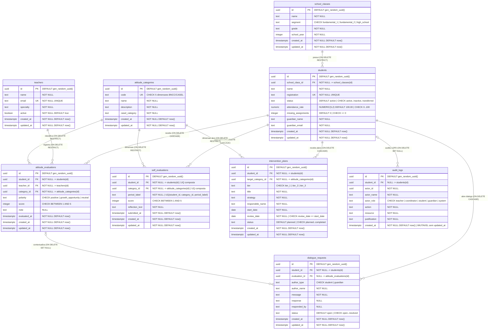

# EduAtitude — Diagrama MER (Modelo Entidade-Relacionamento)

Documentação do **MER (Modelo Entidade-Relacionamento)** do sistema EduAtitude (PostgreSQL / Supabase), refletindo as tabelas, relacionamentos, restrições, índices e triggers atualmente implementados no repositório.

> [!NOTE]
> **Fontes de verdade inspecionadas:**
> - Esquema SQL: [20261127222000_initial_schema.sql](../supabase/migrations/20261127222000_initial_schema.sql)
> - Tipos de domínio: [domain.ts](../src/types/domain.ts)

---

## Modelo Entidade-Relacionamento (PostgreSQL / Supabase)

Representa as **9 tabelas**, chaves primárias (`UUID`), chaves estrangeiras com políticas `ON DELETE`, restrições `UNIQUE`/`CHECK` e a trilha imutável de auditoria LGPD definidas na migration inicial.

### Resumo de Restrições, Índices e Triggers Implementados no Banco

| Mecanismo | Detalhes |
| :--- | :--- |
| **Unicidade (`UNIQUE`)** | `teachers(email)`, `attitude_categories(code)`, `students(registration)`, `self_evaluations(student_id, category_id, period_label)` |
| **Integridade (`CHECK`)** | Enumerações de domínio em todas as colunas categóricas; `attendance_rate BETWEEN 0 AND 100`; `missing_assignments >= 0`; `score BETWEEN 1 AND 5`; `review_date >= start_date` |
| **Índices (13)** | `idx_students_school_class_id`, `idx_students_status`, `idx_evaluations_student_id`, `idx_evaluations_teacher_id`, `idx_evaluations_category_id`, `idx_evaluations_evaluated_at`, `idx_self_evaluations_student_id`, `idx_self_evaluations_category_id`, `idx_interventions_student_tier`, `idx_interventions_target_category_id`, `idx_dialogues_student_status`, `idx_dialogues_evaluation_id`, `idx_audit_logs_student_created` |
| **Triggers** | `set_updated_at()` (`BEFORE UPDATE`) nas 8 tabelas mutáveis; `prevent_audit_log_mutation()` (`BEFORE UPDATE OR DELETE`) em `audit_logs`, permitindo apenas `student_id -> NULL` via `ON DELETE SET NULL` |
