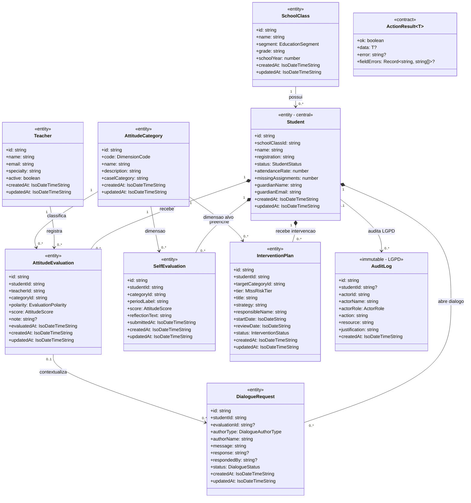
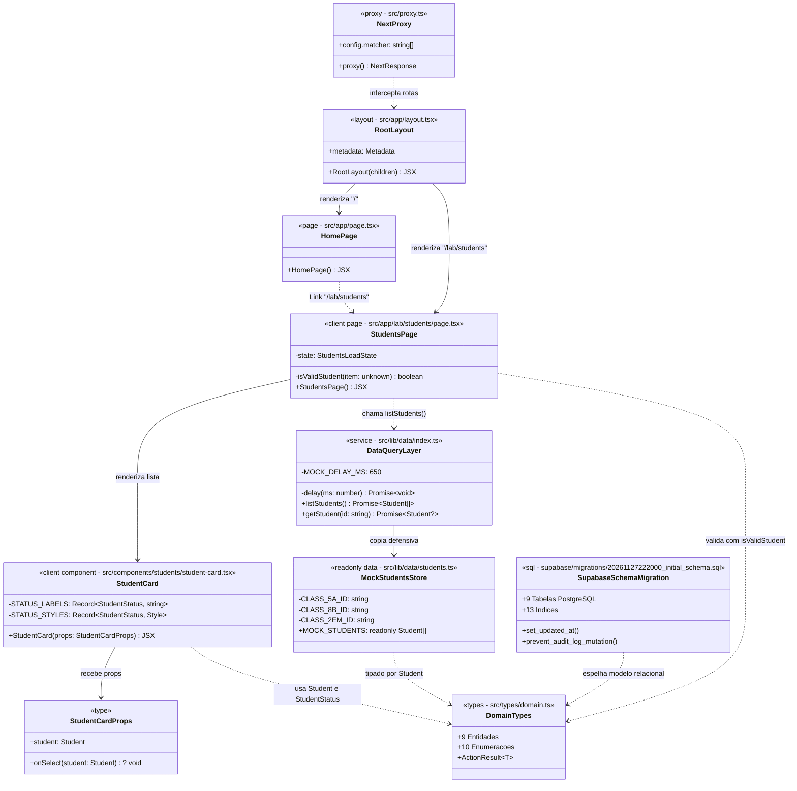
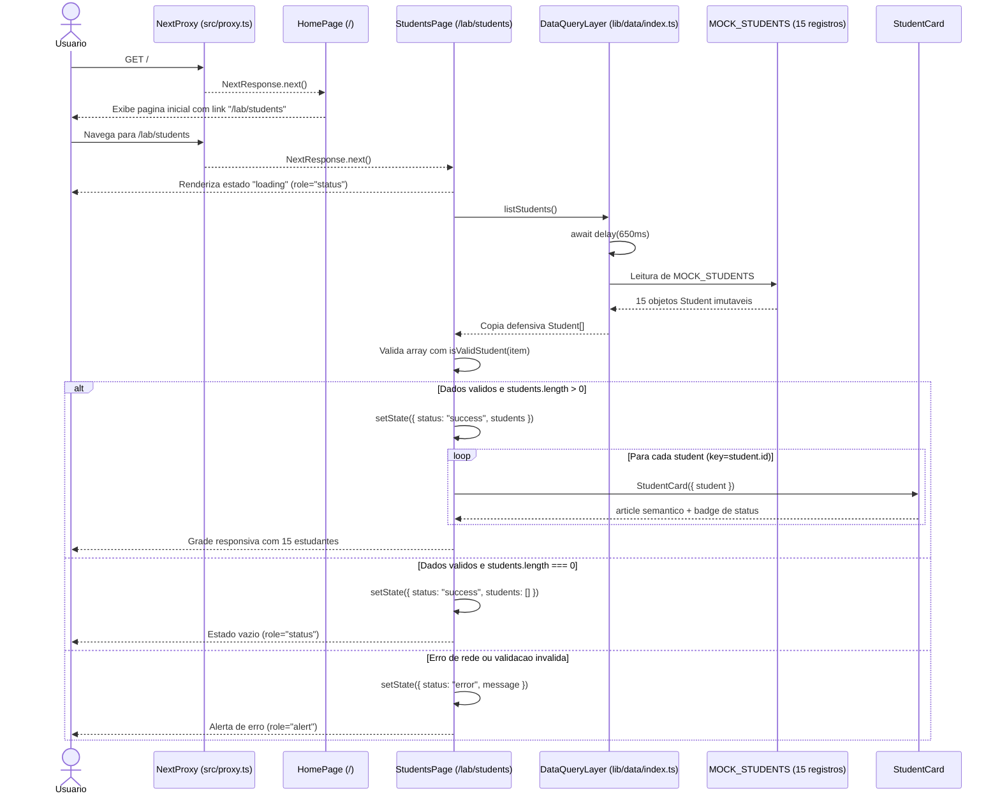
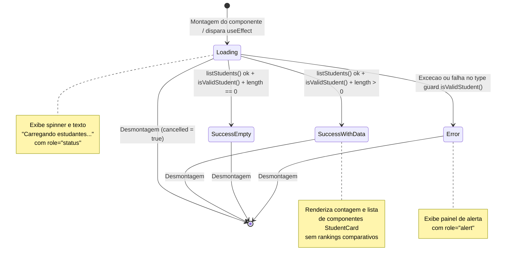

# EduAtitude — Diagramas UML do Sistema

Documentação dos diagramas **UML** (Classes de Domínio, Enumerações, Arquitetura Implementada, Sequência e Máquina de Estados) gerados estritamente a partir dos arquivos, tipos, migração SQL e funcionalidades atualmente implementadas no repositório.

> [!NOTE]
> **Fontes de verdade inspecionadas:**
> - Tipos de domínio: [domain.ts](file:///c:/Users/claud/Desktop/projeto/src/types/domain.ts)
> - Camada mock e consultas: [students.ts](file:///c:/Users/claud/Desktop/projeto/src/lib/data/students.ts), [index.ts](file:///c:/Users/claud/Desktop/projeto/src/lib/data/index.ts)
> - Interface e roteamento: [layout.tsx](file:///c:/Users/claud/Desktop/projeto/src/app/layout.tsx), [page.tsx](file:///c:/Users/claud/Desktop/projeto/src/app/page.tsx), [students/page.tsx](file:///c:/Users/claud/Desktop/projeto/src/app/lab/students/page.tsx), [student-card.tsx](file:///c:/Users/claud/Desktop/projeto/src/components/students/student-card.tsx), [proxy.ts](file:///c:/Users/claud/Desktop/projeto/src/proxy.ts)
> - Esquema SQL: [20261127222000_initial_schema.sql](file:///c:/Users/claud/Desktop/projeto/supabase/migrations/20261127222000_initial_schema.sql)

---

## 1. UML — Diagrama de Classes de Domínio

Mapeamento fiel das 9 entidades, 10 enumerações (uniões de literais) e do contrato `ActionResult<T>` definidos em [domain.ts](file:///c:/Users/claud/Desktop/projeto/src/types/domain.ts).

### Enumerações de Domínio (`src/types/domain.ts`)

```mermaid
classDiagram
    direction LR

    class StudentStatus {
        <<enumeration>>
        active
        inactive
        transferred
    }

    class AttitudeScore {
        <<enumeration>>
        1
        2
        3
        4
        5
    }

    class EducationSegment {
        <<enumeration>>
        fundamental_1
        fundamental_2
        high_school
    }

    class DimensionCode {
        <<enumeration>>
        responsabilidade
        colaboracao
        autonomia
        participacao
        respeito
    }

    class EvaluationPolarity {
        <<enumeration>>
        positive
        growth_opportunity
        neutral
    }

    class MtssRiskTier {
        <<enumeration>>
        tier_1
        tier_2
        tier_3
    }

    class InterventionStatus {
        <<enumeration>>
        planned
        in_progress
        under_review
        completed
    }

    class DialogueAuthorType {
        <<enumeration>>
        student
        guardian
    }

    class DialogueStatus {
        <<enumeration>>
        open
        in_review
        answered
        resolved
    }

    class ActorRole {
        <<enumeration>>
        teacher
        coordinator
        student
        guardian
        system
    }
```

---

## 2. UML — Arquitetura e Módulos Atualmente Implementados

Mostra os componentes reais em execução no Marco 1 (Next.js 16 App Router + camada mock) e sua relação com a camada de banco de dados preparada na migration SQL.

---

## 3. UML — Diagrama de Sequência (Funcionalidade Implementada `/lab/students`)

Detalha o fluxo completo de navegação, interceptação pelo proxy, consulta assíncrona com latência simulada (`650 ms`), validação em runtime via type guard e renderização dos cartões.

---

## 4. UML — Diagrama de Estados da Interface (`StudentsPage`)

Representa a máquina de estados discriminada (`StudentsLoadState`) e o estado vazio derivado implementados em [students/page.tsx](file:///c:/Users/claud/Desktop/projeto/src/app/lab/students/page.tsx).

